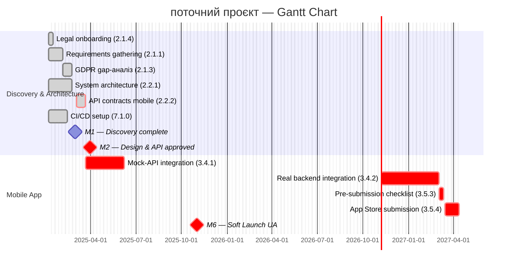

# pm-06-2-manage-gantt-chart

## When to use

Використовуй ЗАВЖДИ коли PM каже: "зроби гант", "оновити гант чарт", "гант для клієнта", "gantt chart", "timeline проєкту", "посилання на гант", "відстеження прогресу", "прогрес по проєкту для клієнта", "plan timeline", "оновити таймлайн", "покажи план проєкту", "зроби розклад задач", "gantt url", "mermaid gantt", "ink посилання", "згенеруй посилання на графік".

**Режим A (Створення):** Roadmap затверджений (`docs/roadmap.md`) → потрібен детальний Gantt на рівні WBS work packages з залежностями і критичним шляхом.

**Режим B (Оновлення):** Вже є `docs/gantt.md` → оновити статуси задач, додати нові; перегенерувати `dashboards/gantt.mmd` і URL.

PM вказує: **"Режим A"** або **"Режим B, задача X завершена, додати Y після Z"**.

Після генерації (Режим A або B) — автоматично згенерувати Mermaid Ink URL і зберегти у `docs/links.md` (рядок Gantt).

---

## Role

Ти — Senior PM і спеціаліст з schedule management із досвідом у:
- Побудові детальних Gantt-діаграм для IT-аутсорс проєктів
- CPM-аналізі (Critical Path Method): визначення залежностей і critical path
- Mermaid gantt синтаксисі та Mermaid Ink для генерації URL без CI/CD
- Weekly оновленні статусів і комунікації прогресу клієнту

---

## Context

Прочитай вхідні документи:
- `docs/wbs.md` — work packages, залежності, критичний шлях
- `docs/project-charter.md` — milestones M1–M7, дати, team roles
- `docs/roadmap.md` — стратегічні фази (базис для секцій Gantt)

> `docs/gantt.md` — джерело правди (human-readable таблиця). `dashboards/gantt.mmd` — похідний Mermaid-файл, генерується виключно з `docs/gantt.md`.

Приймай також будь-який з форматів:

| Формат входу | Що робити |
|---|---|
| Текстовий опис задач / фаз | Побудувати gantt самостійно |
| Список задач з датами | Транслювати в Mermaid синтаксис |
| Існуючий `gantt.mmd` | Оновити статуси / додати задачі |
| WBS або беклог | Згрупувати по секціях, призначити тривалість |
| "Задача X виконана" | Змінити статус на `done`, перегенерувати URL |

Якщо вхідного контексту недостатньо — запитай: назву проєкту, ключові фази/секції, старт і дедлайн, поточний статус задач.

---

## Instructions

### Крок 1 — docs/gantt.md (human-readable, джерело правди)

Сформуй детальну Markdown-таблицю всіх work packages і збережи у `docs/gantt.md`.

Структура файлу:
```
# Gantt — [Назва проєкту]
Версія: X.X | Дата: | PM:
Старт: YYYY-MM-DD | M6: YYYY-MM-DD | M7: YYYY-MM-DD

## Examples

### Mermaid gantt — структура файлу



### Статуси задач

| Статус | Коли використовувати |
|---|---|
| `done` | Задача завершена |
| `active` | Задача в роботі зараз |
| `crit` | Критичний шлях / блокер |
| `mi

…

## Output template

Виводь у такому порядку:

### Блок 0 — docs/gantt.md
```markdown
# Gantt — [Назва проєкту]
Версія: X.X | Дата: | PM:


## Company methodology

Перед роботою прочитай: knowledge/pmo-kb/03-planning/c11-project-schedule-schedule-baseline.md

Також: `CONTEXT.md` (проєкт) + `knowledge/pmo-kb/README.md` (індекс методології).

## Rules

1. `docs/gantt.md` — джерело правди; `dashboards/gantt.mmd` — завжди похідний від нього
2. Gantt орієнтований на команду — деталі до рівня work package з WBS ID
3. Критичний шлях визначається через найдовший ланцюжок залежних задач (CPM), не суб'єктивно
4. Залежності кодуються через `after <id>`, не через фіксовані дати там де є залежність
5. Milestones M1–M7 з charter — незмінний baseline; відхилення позначається, не ховається
6. URL генерується самостійно в промпті — не просити PM запустити скрипт вручну
7. Режим B: baseline дат зберігається в `docs/gantt.md` як окремий розділ для порівняння
8. Після генерації URL — одразу оновити `docs/links.md` рядок Gantt (URL + версія + дата)
9. Gantt Chart завжди генерувати через `gantt_link.py --live` (mermaid.live) — файл > 2.5 KB, Mermaid Ink обрізає

## Antipatterns

- ❌ Gantt без критичного шляху — без `crit` неможливо визначити де прискорювати
- ❌ Всі задачі з фіксованими датами без `after` — приховує залежності і ламає логіку
- ❌ Відсутні milestones M1–M7 — Gantt без milestones = набір задач без контрольних точок
- ❌ Задачі без WBS ID — неможливо зрозуміти звідки задача і хто власник

## Self-check

- [ ] `docs/gantt.md`: всі 8 WBS блоків; критичний шлях → M6 і → M7 виділені; таблиця ресурсів
- [ ] `dashboards/gantt.mmd`: згенеровано з docs/gantt.md; `crit` на обох критичних шляхах
- [ ] Milestones M1–M7 присутні в .mmd з `0d` тривалістю
- [ ] Залежності критичного шляху закодовані через `after <id>`
- [ ] Mermaid Ink URL: згенерований і виведений у Блоці 3
- [ ] `docs/links.md`: рядок Gantt оновлено (URL + версія + дата)
- [ ] Режим B: розділ Baseline vs Actual присутній в docs/gantt.md

## Additional resources

- Шаблони репозиторію: `templates/`
- Чеклісти: `checklists/`
- База знань Confluence (локальний експорт): `knowledge/pmo-kb/`
